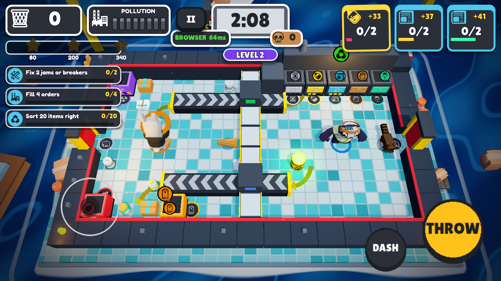
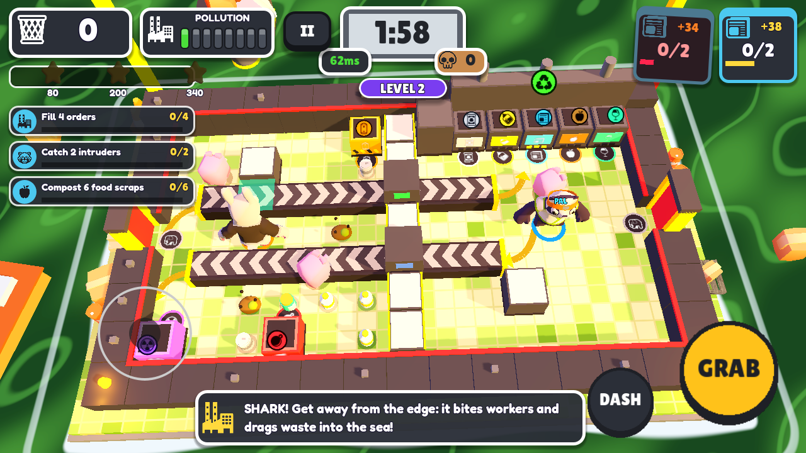

<p align="center"></p>

<h1 align="center">TRASH PANIC!</h1>

<p align="center"><b>The co-op mobile game where recycling goes horribly, educationally wrong.</b><br>
2 players · online · 3-minute shifts · Android, iOS and Web</p>

<p align="center"></p>

## Play it

| Platform | How |
|---|---|
| **Android 7+** | Download `TrashPanic-v1.0-android.apk` from the **[latest release](../../releases/latest)**, open it on your phone, allow installs from your browser, tap Install. |
| **Web (phones and computers)** | Open **https://trash-panic.hasanghorbel.workers.dev** in Chrome, Edge or Safari. On iPhone: Share → *Add to Home Screen* to play it full screen like an app. |
| **iOS 14+ (native)** | Download `TrashPanic-v1.0-ios-xcode.zip` from the release and build it on a Mac with Xcode and your Apple ID (steps in `BUILD_ON_MAC.txt` inside the zip). |
| **Trailer** | `TrashPanic-trailer.mp4` in the release, 36 seconds. |

Android, iOS and web players can play together, as long as they run the same version.

## How to play

A broken machine called **the Dropper** rains waste onto a recycling floor split by a rail. Every item lands on the side that **can’t** deliver it, so the two of you have to pass, throw and shout.

- **Joystick** to walk, **one big action button** that says what it will do: GRAB, DROP, THROW, FIX, SHOO, OPEN, and **DASH**.
- Put cans, bottles, paper, glass, wood, food and e-waste into the right machine input. Bombs, nuclear barrels and batteries go into their special bins, or out of an open door to the hazmat truck.
- Chain right deliveries for a **combo** (up to ×3), finish endless **quests**, fill **orders**, and aim for **3 stars**.
- Watch out for raccoons, pigs, chickens, rogue robots, an elephant, a shark, and chaos events: blackouts, hurricanes, low gravity.

<p align="center">



</p>

| Map | Teaches | Twist |
|---|---|---|
| The Sorting Floor | everyday recycling | a shark bites the edges |
| Rot & Roll | compost | food rots, the floor tilts |
| Circuit Breakers | e-waste | machine inputs trip, robots go rogue |

Full details: [`TRASH_PANIC_gameplay.pdf`](TRASH_PANIC_gameplay.pdf) · technical dossier: [`TRASH_PANIC_technical.pdf`](TRASH_PANIC_technical.pdf) · pitch: [`TRASH_PANIC_pitch_script.pdf`](TRASH_PANIC_pitch_script.pdf), [`presentation/`](presentation/) (open `index.html`).

## Project layout

| Folder | What |
|---|---|
| `game/` | The Godot 4.7 project (GDScript): `core/` rules and simulation, `app/` screens and HUD, `net/` online play, `rooms/` map layouts, `tests/` |
| `game/android/build/src/main/java/com/lastdrop/netinfo/` | Kotlin plugin that detects 5G SA / 5G NSA / 4G / Wi-Fi |
| `server/` | Cloudflare Worker + Durable Object: matchmaking, shift clock and relay (`PROTOCOL.md`) |
| `tools/` | Build, test and screenshot scripts |
| `design/` | Icon source and the trailer |
| `presentation/` | The 3D pitch presentation (works offline) |

## Build and test

Requirements: Godot 4.7.2 with export templates, Node 20+, the Android SDK for APKs, a Mac with Xcode for iOS.

```sh
tools/test.sh                      # rule tests, bot soak, physics, room walk, server tests
tools/build_web.sh release         # web build into build/web
tools/build_android.sh debug       # debug APK (release needs your own signing config)
godot --headless --path game --export-release iOS ../build/ios/TrashPanic.ipa   # Xcode project
cd server && npx wrangler@4 dev    # local server; deploy with npx wrangler@4 deploy
```

Release signing reads `~/.config/the-last-drop/release-signing.env` (never committed).

## Credits

Godot Engine (MIT). Art, music and sounds are CC0: Kenney, Quaternius, Juhani Junkala; fonts are OFL. Full list in [`CREDITS.md`](CREDITS.md).

Made for the Green Hackathon, November 2026.
