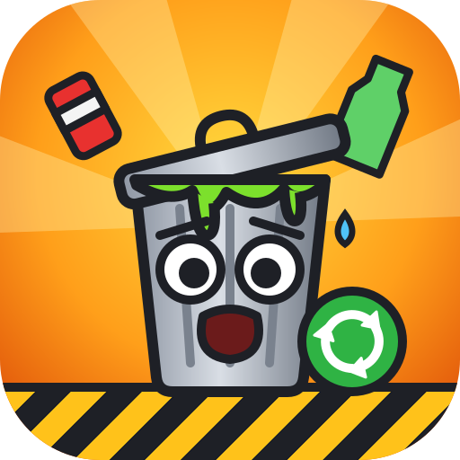
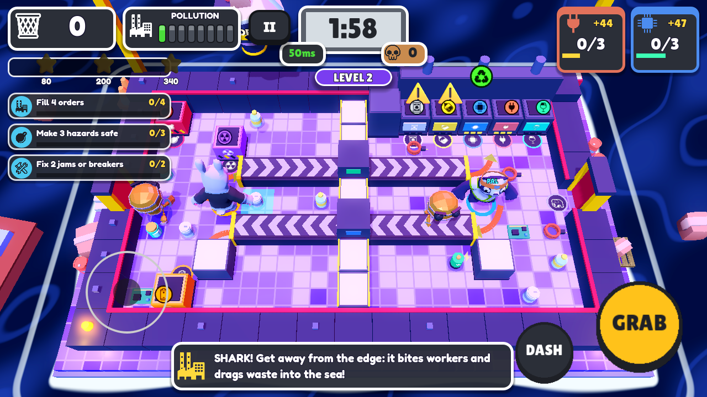
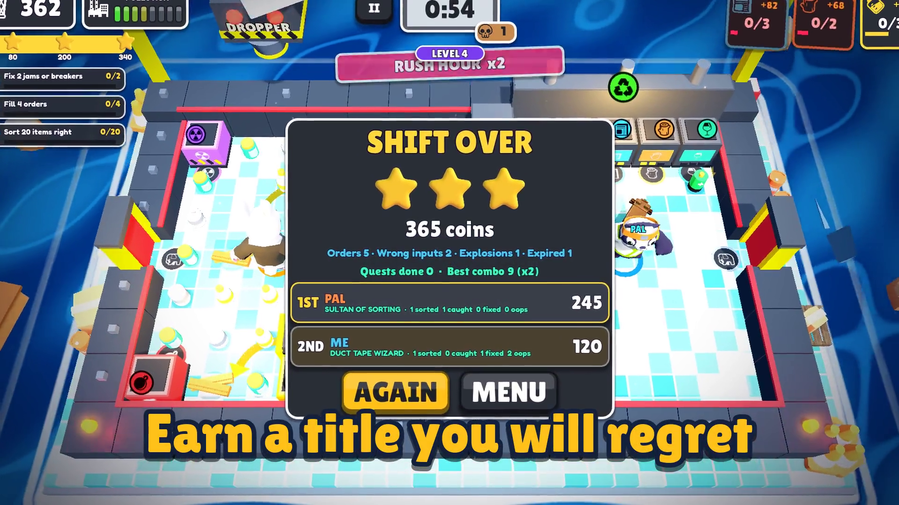

<h1 align="center">TRASH PANIC!</h1>

<b>The co-op mobile game where recycling goes horribly, educationally wrong.</b> 
2 players · online · 3-minute shifts · Android and iOS

## Download

Get the files from the **[latest release](../../releases/latest)**:

| Platform | File | How to install |
|---|---|---|
| Android 7+ | `TrashPanic-v1.0-android.apk` | Open the file on your phone, allow “install unknown apps” for your browser or file manager, tap Install. |
| iOS 14+ | `TrashPanic-v1.0-ios-xcode.zip` | Needs a Mac with Xcode: unzip, open `TrashPanic.xcodeproj`, choose your Apple ID under *Signing & Capabilities*, plug in your iPhone and press Run. Full steps in `BUILD_ON_MAC.txt` inside the zip. |
| Trailer | `TrashPanic-trailer.mp4` | 36 seconds of the game. |

Both players need the same version to be matched online. Android and iOS players can play together.

## How to play

A broken machine called **the Dropper** rains waste onto a recycling floor split by a rail. Every item lands on the side that **can’t** deliver it, so the two of you have to pass, throw and shout.

- **Joystick** to walk, **one big action button** that says what it will do: GRAB, DROP, THROW, FIX, SHOO, OPEN, and **DASH**.
- Put cans, bottles, paper, glass, wood, food and e-waste into the right machine input. Bombs, nuclear barrels and batteries go into their special bins, or out of an open door to the hazmat truck.
- Chain right deliveries for a **combo** (up to ×3), finish endless **quests**, fill **orders**, and aim for **3 stars**.
- Watch out for raccoons, pigs, chickens, rogue robots, an elephant, a shark, and chaos events: blackouts, hurricanes, low gravity.

## Three maps

| Map | Teaches | Twist |
|---|---|---|
| The Sorting Floor | everyday recycling | a shark bites the edges |
| Rot & Roll | compost | food rots, the floor tilts |
| Circuit Breakers | e-waste | machine inputs trip, robots go rogue |

## Built with

Godot 4.7 (GL Compatibility), a Cloudflare Workers + Durable Objects relay at the network edge, and open CC0 art and music (Kenney, Quaternius, Juhani Junkala). The Android build detects 5G SA / 5G NSA / 4G / Wi-Fi and shows the network and ping in game.

Made for the Green Hackathon, November 2026.
